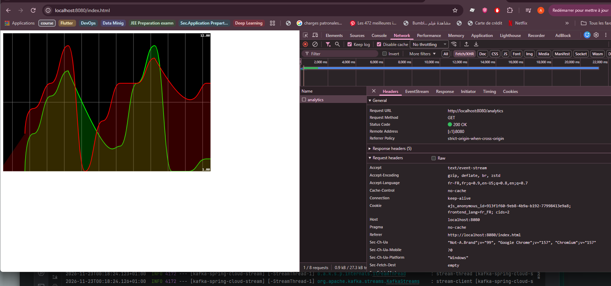

# 📊 Kafka & Spring Cloud Stream — Real-Time Page Event Analytics

Application de traitement de flux de données en temps réel (*Event-Driven Architecture*) développée avec **Spring Boot**, **Spring Cloud Stream** et **Apache Kafka / Kafka Streams**.

Ce projet simule, produit, consomme et analyse des événements de navigation (`PageEvent`) en temps réel à l'aide de fenêtres temporelles (*Tumbling Windows*) et d'un tableau de bord réactif.

---

##  Stack Technique

- **Langage** : Java 17 / 21
- **Framework** : Spring Boot 3.x
- **Messaging & Streaming** : Spring Cloud Stream, Apache Kafka, Kafka Streams
- **Programmation Réactive** : Spring WebFlux (`Flux` / SSE)
- **Gestion de projet** : Maven

---

## Démarrage Rapide

### 1. Prérequis
- **JDK 17** ou **JDK 21**
- **Maven 3.8+**
- **Apache Kafka** & **Zookeeper** (ou Kafka en mode KRaft / Docker) démarrés sur `localhost:9092`


---

### Exemple d'utilisation
1. **Publier un événement :**
   ```bash
   curl "http://localhost:8080/publish?name=P1&topic=T2"
   ```
2. **Observer les statistiques en direct :**
   Ouvrez `http://localhost:8080/analytics` dans votre navigateur (ou accédez à `http://localhost:8080/index.html` si vous avez intégré le graphique temps réel).




