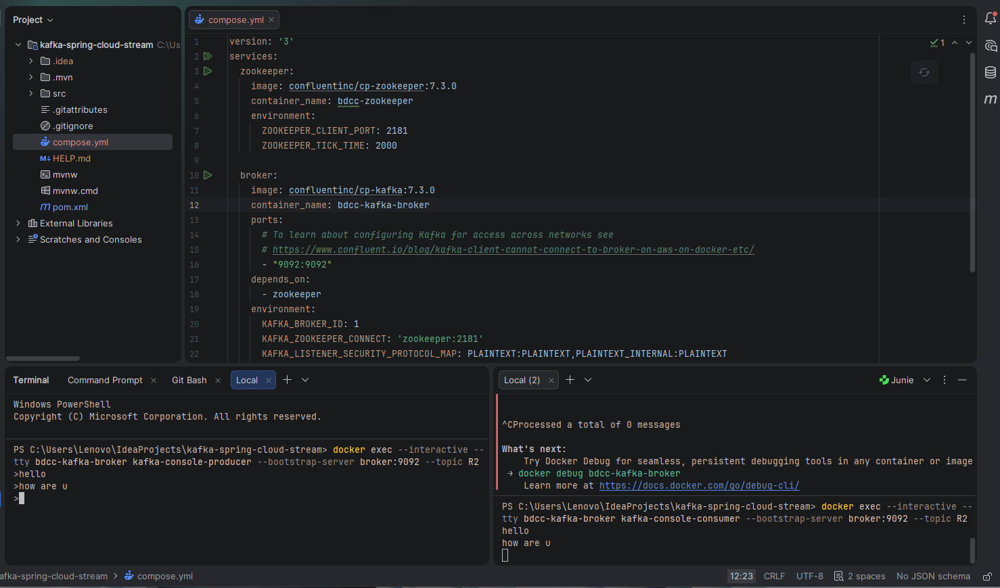
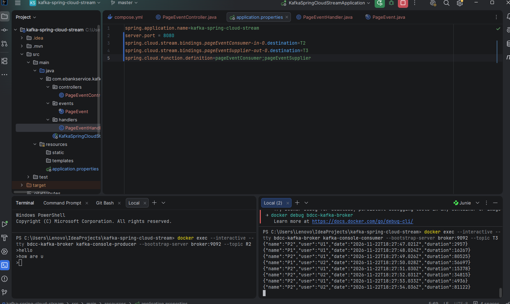
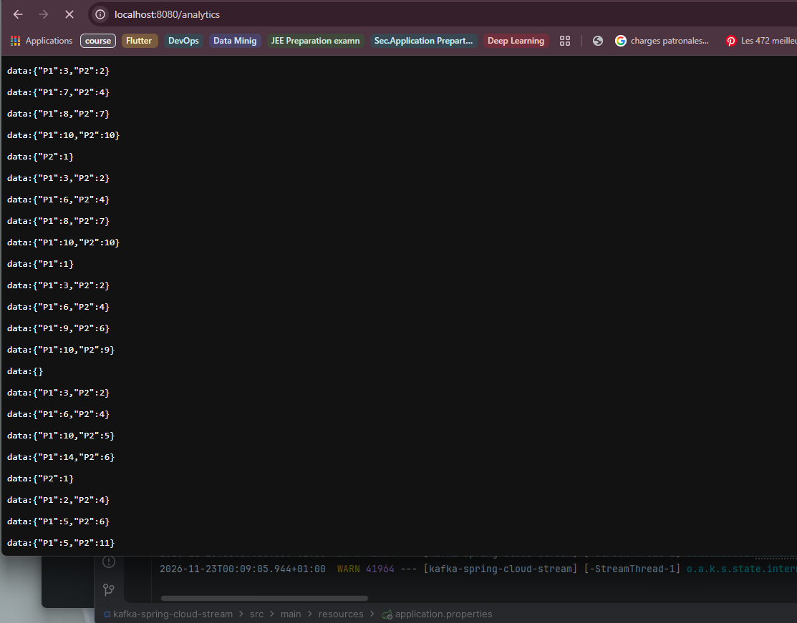

# Application Kafka et Spring Cloud

Cette application traite des événements de navigation en temps réel avec **Spring Boot**, **Spring Cloud Stream** et **Kafka**.

Elle produit, consomme et analyse des événements `PageEvent` avec des fenêtres de cinq secondes et un tableau de bord actualisé en direct.

---

##  Stack Technique

- **Langage** : Java 17 / 21
- **Framework** : Spring Boot 3.x
- **Messaging & Streaming** : Spring Cloud Stream, Apache Kafka, Kafka Streams
- **Programmation Réactive** : Spring WebFlux (`Flux` / SSE)
- **Gestion de projet** : Maven

---

## Démarrage rapide

### 1. Prérequis
- **JDK 17** ou **JDK 21**
- **Maven 3.8+**
- Docker Desktop (pour démarrer Kafka et ZooKeeper via Compose)


---

### Lancer le projet

Depuis la racine du dépôt :

```bash
docker compose up -d
MAVEN_SKIP_RC=true JAVA_HOME="$(/usr/libexec/java_home -v 17)" ./mvnw spring-boot:run
```

Le `MAVEN_SKIP_RC=true` évite qu’un fichier Maven global local remplace le JDK 17 demandé par le projet. Pour arrêter l’application, interrompez le processus Maven, puis exécutez `docker compose down`.

### Utilisation

1. Publier un événement vers le consommateur `T2` :
   ```bash
   curl "http://localhost:8080/publish?name=P1&topic=T2"
   ```
2. Ouvrir `http://localhost:8080/index.html` pour afficher les statistiques Kafka Streams en direct. Le flux SSE est disponible sur `http://localhost:8080/analytics`.

La source périodique publie aussi ses événements sur `T3`; Kafka Streams filtre les durées supérieures à 100 ms, compte les pages dans des fenêtres de 5 secondes et écrit les résultats dans `T4`.

### Ports utilisés

- `8080` : application Spring Boot et tableau de bord
- `9092` : broker Kafka accessible depuis l’hôte
- `2181` : client ZooKeeper, utilisé sur le réseau Compose

### Tests

```bash
MAVEN_SKIP_RC=true JAVA_HOME="$(/usr/libexec/java_home -v 17)" ./mvnw test
```

Les tests démarrent un broker Kafka embarqué et vérifient le démarrage HTTP, la page statique, `/publish` et la production d’un résultat agrégé sur `T4`.







